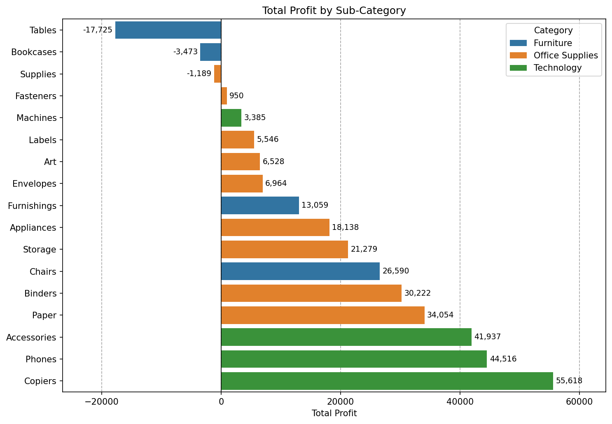
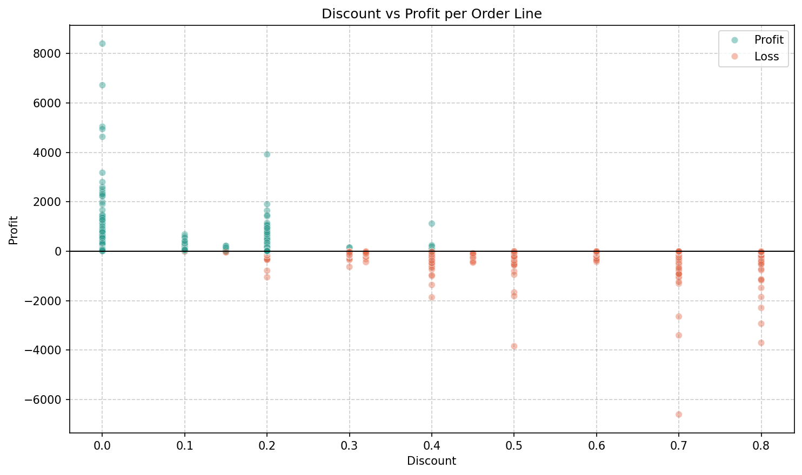
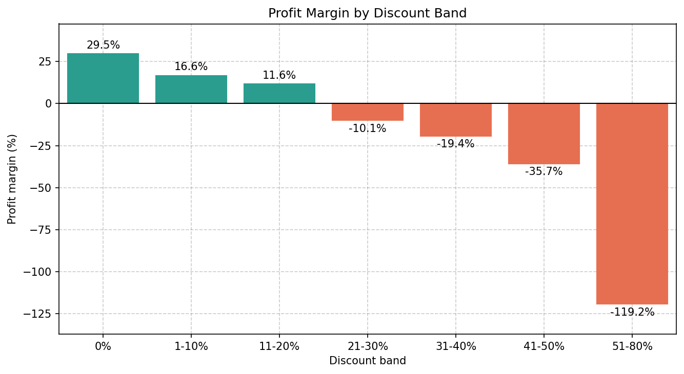
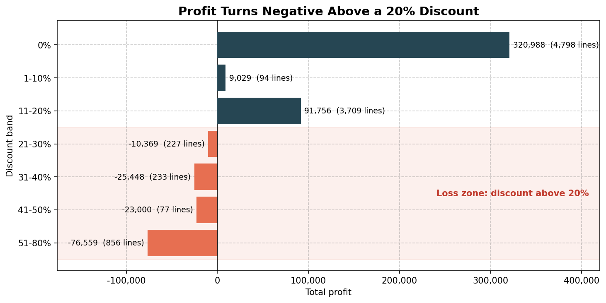
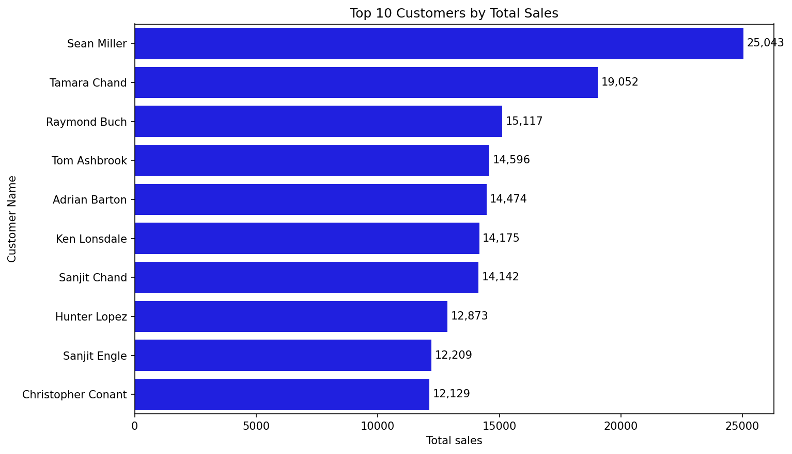
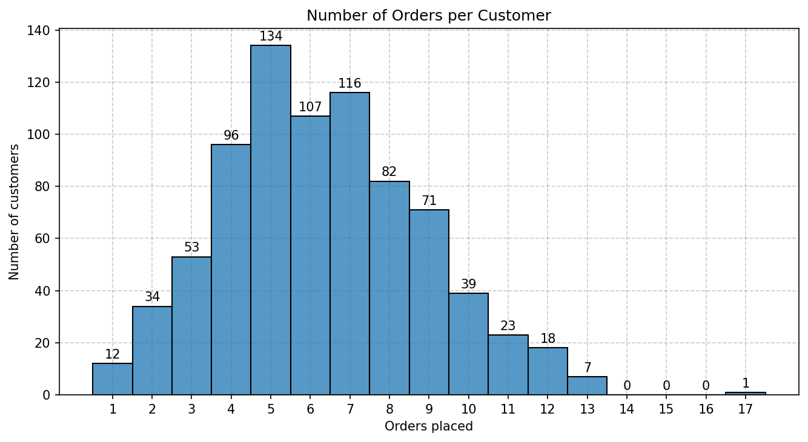
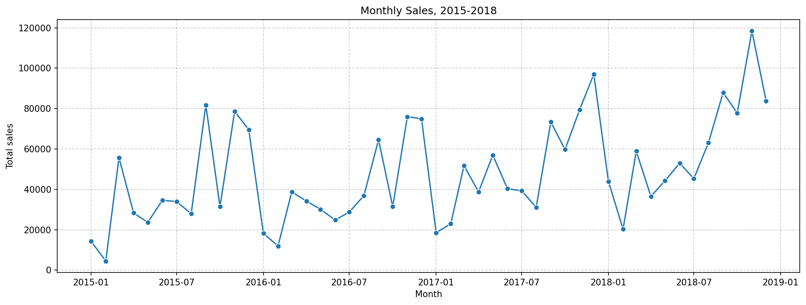
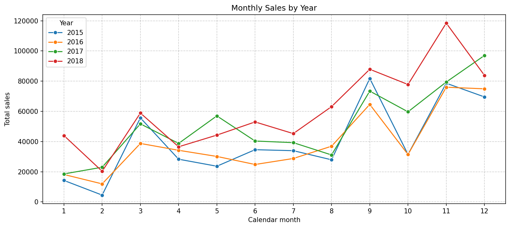
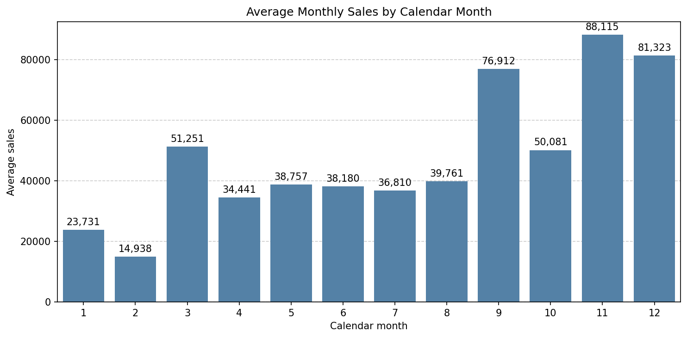
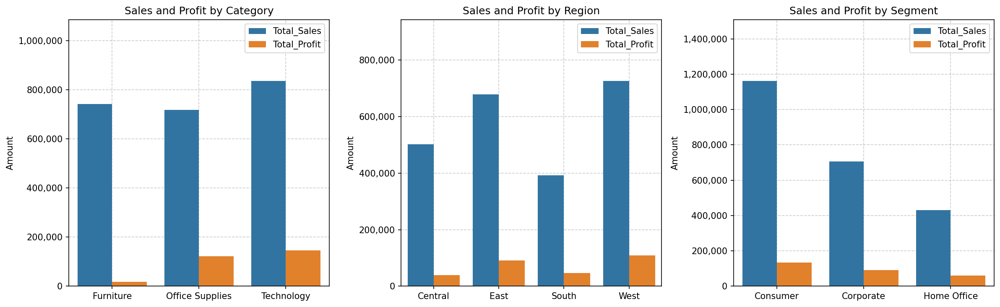

# Datheon: Data Analytics & Power BI Internship
# Task 1: Exploratory Data Analysis (EDA) on Superstore Retail Sales

## Goal
Perform data wrangling, missing-value profiling, and uncover commercial sales distributions.

## Approach
- **Data wrangling:** the raw CSV contained three sheets stacked in one file (Orders, People, Returns). I separated them, kept 9,994 clean order rows, fixed data types and parsed the dates.
- **Data quality:** profiled missing values and duplicates, and explained the 806 blank rows.
- **Analysis:** customer purchase volume, monthly seasonality, category-wise revenue and discount sensitivity.
- **Validation:** the last notebook cell checks the final numbers and prints "All checks passed".

## Dataset Summary

| Metric | Value |
|--------|-------|
| Order rows | 9,994 |
| Customers | 793 |
| Period | Jan 2015 to Dec 2018 (48 months) |
| Total sales | about 2.30M |
| Total profit | about 286K (12.5% margin) |

## Key Findings

1. **Discounts above 20% lose money.** Margin is 29.5% with no discount and negative in every band above 20%.
2. **Tables and Bookcases drag Furniture down.** Furniture is about 32% of sales but only about 6% of profit.
3. **Top customers are not always profitable.** The #1 customer by sales has a negative profit, and 19.5% of customers lose money.
4. **Sales are seasonal.** September, November and December give about 43% of a typical year's sales.
5. **Sales grow faster than profit.** In 2018, sales grew 20.4% but profit only 14.2%.

Full evidence, recommendations and limitations: [Executive_Takeaways.md](Executive_Takeaways.md)

## Visual Highlights

<table>
  <tr>
    <td width="33%"> Profit by sub-category</td>
    <td width="33%"> Discount vs profit</td>
    <td width="33%"> Margin by discount band</td>
  </tr>
  <tr>
    <td width="33%"> Profit by discount band</td>
    <td width="33%"> Top 10 customers</td>
    <td width="33%"> Orders per customer</td>
  </tr>
  <tr>
    <td width="33%"> Monthly sales</td>
    <td width="33%"> Seasonality by year</td>
    <td width="33%"> Average sales by month</td>
  </tr>
  <tr>
    <td colspan="3"> Sales and profit by category, region and segment</td>
  </tr>
</table>

## How to Run

1. **Download the dataset:** open the [Data Set folder](Data%20Set), click `superstore_sales.csv`, then click the download button.
2. **Open the notebook in Google Colab:**
   
3. **Upload the dataset:** click the folder icon on the left side of Colab, then the upload icon, and choose `superstore_sales.csv`.
4. Click **Runtime → Run all**.
5. The last cell prints "All checks passed" when everything has run correctly.

To run locally: `pip install -r ../requirements.txt`, put `superstore_sales.csv` next to the notebook, and open the notebook in Jupyter.

## Folder Contents

| Item | Description |
|------|-------------|
| Notebook (`.ipynb`) | Full analysis with code, charts and notes |
| `Executive_Takeaways.md` | 5 executive takeaways plus a bonus one, with limitations |
| `Charts/` | PNG charts exported from the notebook |
| `Data Set/` | Original `superstore_sales.csv` |
